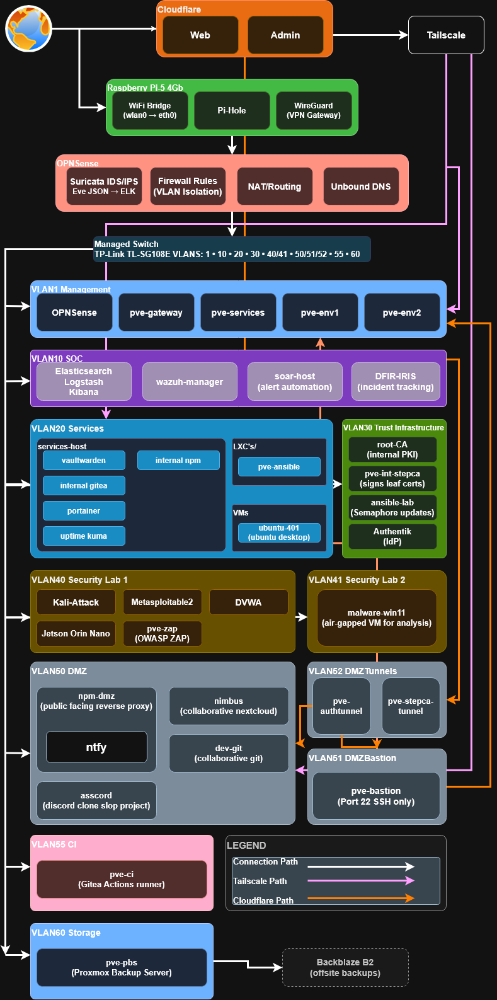

# dcollins-homelab

A self-built, enterprise-style homelab running production-grade infrastructure across a four-node Proxmox cluster. This repository documents the architecture, design decisions, and operational procedures behind what I have built and where it is going.

Everything here is real and running. Where something is planned or in progress, it is noted as such.

---

## What This Is

This is not a tutorial lab. It is a working environment I use to develop hands-on skills in network engineering, security operations, virtualization, and systems administration. I built it from scratch, manage it myself, and treat it with the same discipline I would apply to a professional environment; documented procedures, internal PKI, segmented networks, centralized logging, and a running SIEM.

The stack covers:

- Four-node Proxmox VE cluster with production VMs across segmented VLANs
- OPNSense firewall with Suricata IDS and full VLAN isolation
- Wazuh SIEM with agents deployed across cluster endpoints
- Elastic Stack 8.19 with active security dashboards covering detection, infrastructure, and compliance
- Internal PKI with an offline Root CA and step-ca issuing short-lived TLS certificates over ACME, plus SSH certificates for bastion login
- Self-hosted identity (Authentik) with MFA in front of admin access
- Alert automation (Shuffle SOAR) and incident case management (DFIR-IRIS)
- Dedicated security lab environment for penetration testing, adversary simulation and web app scanning
- Cloudflare Zero Trust (WARP) to a certificate-only SSH bastion as the admin path, with Tailscale as break-glass
- Nightly backups to Proxmox Backup Server with an encrypted offsite copy in Backblaze B2

---

## Network Architecture

The network is segmented into discrete VLANs enforced at both the firewall and managed switch layers. Each VLAN operates under a default-deny firewall policy with explicit allowlists for required traffic flows. No VLAN has unrestricted access to another.

Full topology documentation: [docs/Network.md](docs/Network.md). Per-VLAN detail lives in [docs/Network/](docs/Network/).

### VLAN Summary

| VLAN | Name | Purpose | Status |
|---|---|---|---|
| 1 | Management | Proxmox nodes, OPNSense management | Live |
| 10 | SOC | ELK Stack, Wazuh Manager, Shuffle SOAR, DFIR-IRIS | Live |
| 20 | Services | Self-hosted services (Gitea, Vaultwarden, Portainer, Uptime Kuma, internal NPM), Ubuntu desktop VM | Live |
| 30 | Trust Infrastructure | Root CA, step-ca, Authentik IdP, Ansible/Semaphore update automation | Live |
| 40 | Security Lab 1 | Kali, Metasploitable2, DVWA, OWASP ZAP scanner, Jetson (flat network) | Live |
| 41 | Security Lab 2 | Windows 11 malware sandbox (fully air-gapped) | Live |
| 50 | DMZ | Public-facing reverse proxy, push notifications, collaboration services | Live |
| 51 | DMZBastion | Certificate-only SSH bastion, isolated from the rest of the DMZ | Live |
| 52 | DMZTunnels | Cloudflare Tunnel connectors, so every tunnel-to-target path crosses the firewall | Live |
| 55 | CI | Isolated CI runner, outbound internet only | Live |
| 60 | Storage | Proxmox Backup Server | Live |

---

## Hardware

### Proxmox Cluster

| Node | Hardware | Role |
|---|---|---|
| pve-gateway | HP EliteDesk G3 | Security lab VMs, attack platform |
| pve-services | HP EliteDesk G3 | Internal services, PKI, trust infrastructure |
| pve-env1 | HP EliteDesk G5 | Production services, Docker workloads, SOC automation |
| pve-env2 | HP EliteDesk G6 | SOC stack (ELK + Wazuh) |

### Supporting Hardware

| Device | Role |
|---|---|
| Heimdall (RPi5) | WiFi bridge, WAN gateway, Pi-hole DNS, WireGuard VPN |
| OPNSense (HP EliteDesk G3) | Dedicated firewall, Suricata IDS, VLAN routing |
| TP-Link TL-SG108E | Managed switch, VLAN tagging and trunking |
| Jetson Orin Nano | AI inference node, VLAN40, racked |

Per-host detail lives in [docs/Hosts/](docs/Hosts/).

### VM and LXC Inventory

| Guest | Host | Network | Role | Status |
|---|---|---|---|---|
| services-host (VM 200) | pve-env1 | VLAN20 | Docker Host 1 | Live |
| soar-host (VM 602) | pve-env1 | VLAN10 | Shuffle SOAR, alert automation | Live |
| docker-host.template (VM 603) | pve-env1 | n/a | Template for cloning new Docker-host VMs | Template |
| pve-iris (VM 604) | pve-env1 | VLAN10 | DFIR-IRIS, incident case tracking | Live |
| soc-stack (VM 600) | pve-env2 | VLAN10 | Elasticsearch, Logstash, Kibana | Live |
| wazuh-manager (VM 601) | pve-env2 | VLAN10 | Wazuh SIEM manager | Live |
| pve-pbs (VM 6000) | pve-env1 | VLAN60 | Proxmox Backup Server, synced to Backblaze B2 | Live |
| pve-ci (VM 800) | pve-env1 | VLAN55 | Gitea Actions CI runner | Live |
| npm-dmz (LXC 2200) | pve-env1 | VLAN50 | Public-facing reverse proxy, hosts ntfy | Live |
| dev-git (LXC 3300) | pve-env1 | VLAN50 | Collaboration Gitea for an outside contributor | Live |
| nimbus (LXC 3400) | pve-env1 | VLAN50 | Nextcloud file sharing | Live |
| ubuntu-401 (VM 401) | pve-services | VLAN20 | Ubuntu desktop | Live |
| pve-ca-root (VM 500) | pve-services | VLAN30 | Root CA, offline except for CA operations | Live |
| pve-ca-intermediate (VM 501) | pve-services | VLAN30 | Legacy OpenSSL Intermediate CA, being retired | Live |
| pve-int-stepca (LXC 511) | pve-services | VLAN30 | step-ca: TLS certificates over ACME, SSH user CA | Live |
| Authentik (LXC 2201) | pve-services | VLAN30 | Self-hosted IdP/SSO | Live |
| ansible-lab (LXC 1101) | pve-services | VLAN30 | Semaphore and Ansible for patching the cluster | In progress |
| pve-bastion (LXC 2202) | pve-services | VLAN51 | SSH bastion, certificate-only login over Cloudflare WARP | Live |
| pve-authtunnel (LXC 2100) | pve-services | VLAN52 | Cloudflare Tunnel publishing Authentik for Cloudflare Access | Live |
| pve-stepca-tunnel (LXC 2101) | pve-services | VLAN52 | Cloudflare Tunnel giving enrolled devices a private route to step-ca only | Live |
| kali-attack (VM 300) | pve-gateway | VLAN40 | Penetration testing | Live |
| pve-zap (LXC 1200) | pve-gateway | VLAN40 | OWASP ZAP web app scanner | Live |
| metasploitable2 (VM 301) | pve-gateway | VLAN40 | Vulnerable target | Live |
| dvwa (VM 302) | pve-gateway | VLAN40 | Vulnerable web app | Live |
| malware-win11 (VM 400) | pve-gateway | VLAN41 | Malware analysis sandbox (air-gapped) | Live |

---

## SOC Stack

The SOC environment is built on Elastic Stack 8.19 and Wazuh v4.14, running on dedicated hardware in an isolated VLAN with TLS enforced across all components. Beyond detection and log analysis, the SOC now includes alert automation via Shuffle SOAR and incident case management via DFIR-IRIS, with a debounce workflow that avoids creating a ticket on every transient outage.

Dashboards:

- SIEM Baseline
- OPNSense Firewall
- Proxmox Infrastructure
- Heimdall Gateway
- Jetson
- Suricata SOC
- The full set of official Wazuh dashboards (security events, vulnerability management, compliance, agent status)

Wazuh agents are deployed across cluster endpoints. The Wazuh indexer connects to Elasticsearch over HTTPS using internal PKI certificates.

Full SOC documentation: [docs/SOC-Stack.md](docs/SOC-Stack.md). Phased buildout records: [docs/Projects/soc-stack-buildout/](docs/Projects/soc-stack-buildout/).

---

## Internal PKI

Internal services communicate over TLS using certificates issued by an internal certificate authority hierarchy. The PKI runs on pve-services, on the Trust Infrastructure VLAN alongside Authentik (self-hosted IdP/SSO).

- The Root CA signs intermediates only. Its VM stays powered off except for CA operations.
- step-ca holds the intermediate and issues 60-day leaf certificates over ACME to the services behind the internal reverse proxy, with automated renewal.
- step-ca is also the SSH user CA. Bastion logins use short-lived SSH certificates issued after an Authentik login with MFA, and passwords are disabled.
- The original OpenSSL intermediate is being retired along with the legacy `.local` domain, as services move to `.internal` names.

Full PKI documentation: [docs/PKI.md](docs/PKI.md).

---

## Self-Hosted Services

Running on services-host (pve-env1, VLAN20) via Docker:

| Service | Purpose |
|---|---|
| Gitea | Self-hosted Git server |
| Vaultwarden | Password manager (Bitwarden-compatible) |
| Portainer | Container management |
| Uptime Kuma | Service uptime monitoring |
| Nginx Proxy Manager | Internal reverse proxy, step-ca certificates |

Elsewhere in the lab:

| Service | Where | Purpose |
|---|---|---|
| ntfy | npm-dmz (VLAN50) | Push notifications for alerts |
| nimbus | LXC on pve-env1 (VLAN50) | Nextcloud file sharing, reachable over Tailscale only |
| dev-git | LXC on pve-env1 (VLAN50) | Gitea for collaborating with an outside contributor, reachable over Tailscale only |

---

## Backups

Every guest except the throwaway security lab VMs is backed up nightly to Proxmox Backup Server (VLAN60). A daily sync job copies the encrypted backups to Backblaze B2 for an offsite copy, with its own retention (7 daily, 4 weekly, 6 monthly) and a monthly verify job. Unencrypted backups never leave the lab.

---

## Security Lab

The security lab runs across VLAN40 and VLAN41, fully isolated from all production VLANs. VLAN40 is a flat network hosting Kali Linux, Metasploitable2, DVWA, an OWASP ZAP scanner, and the Jetson Orin Nano, with restricted outbound internet for tool updates. VLAN41 is a separate, fully air-gapped segment reserved for the Windows 11 malware analysis sandbox, with no route to or from any other VLAN, including VLAN40.

Full lab documentation: [docs/Security-Lab.md](docs/Security-Lab.md).

---

## Planned Work

| Item | Description |
|---|---|
| Update automation | Semaphore and Ansible on ansible-lab, rolling patches out to the Proxmox nodes, VMs and LXCs |
| Legacy PKI retirement | Retire the OpenSSL intermediate and the `.local` domain |
| Self-Hosted Website | Personal site and portfolio hosted in DMZ |
| Stoat Messenger | Self-hosted messaging |
| Suricata IPS mode | Promote from detection-only to inline blocking |

---

## Documentation

### Architecture and Infrastructure

| Document | Description |
|---|---|
| [docs/Network.md](docs/Network.md) | Full network topology, VLAN design, and firewall architecture |
| [docs/Infrastructure.md](docs/Infrastructure.md) | Proxmox cluster, node configuration, and VM layout |
| [docs/SOC-Stack.md](docs/SOC-Stack.md) | ELK Stack and Wazuh deployment, dashboards, and agent rollout |
| [docs/PKI.md](docs/PKI.md) | Internal PKI architecture, certificate issuance, and TLS deployment |
| [docs/Security-Lab.md](docs/Security-Lab.md) | Security lab environment and penetration testing setup |
| [docs/Tailscale.md](docs/Tailscale.md) | Tailscale break-glass remote-admin path |

### Hosts, Networks, and Decisions

| Area | Description |
|---|---|
| [docs/Hosts/](docs/Hosts/) | Per-host notes for every node, VM, and LXC |
| [docs/Network/](docs/Network/) | Per-VLAN detail (VLAN1 through VLAN60) |
| [docs/Decisions/](docs/Decisions/) | Design decision records with rationale and trade-offs |

### Standard Operating Procedures

[docs/SOPs/](docs/SOPs/): dependency-ordered, multi-tool processes (VLAN implementation, Cloudflare tunnel, SSH bastion build, VPS hardening, PKI migration, step-ca cutover, and more).

### Runbooks

Task-level, repeatable procedures for operating each piece of software in this stack, distinct from the Incidents and Sessions below, which are historical records rather than reusable procedures. Each folder holds the individual procedures for that tool.

- [OPNSense](docs/Runbooks/opnsense/)
- [Proxmox](docs/Runbooks/proxmox/)
- [Authentik](docs/Runbooks/authentik/)
- [Cloudflare](docs/Runbooks/cloudflare/)
- [ELK Stack](docs/Runbooks/elk/)
- [Wazuh](docs/Runbooks/wazuh/)
- [PKI](docs/Runbooks/pki/)
- [Nginx Proxy Manager](docs/Runbooks/npm/)
- [Pi-hole](docs/Runbooks/pihole/)
- [SSH](docs/Runbooks/ssh/)
- [Tailscale](docs/Runbooks/tailscale/)
- [DFIR-IRIS](docs/Runbooks/dfir-iris/)
- [Gitea](docs/Runbooks/gitea/)
- [Portainer](docs/Runbooks/portainer/)
- [Uptime Kuma](docs/Runbooks/uptime-kuma/)
- [Vaultwarden](docs/Runbooks/vaultwarden/)
- [Ansible](docs/Runbooks/ansible/)
- [Windows](docs/Runbooks/windows/)
- [Docs sanitizer](docs/Runbooks/sanitize/)
- [Linux](docs/Runbooks/linux/)

### Projects

[docs/Projects/](docs/Projects/): multi-session build efforts, including the SOC stack buildout and its implementation records, the AIops VLAN work, and the DHCP/DNS rollout.

### Incidents

[docs/Incidents/](docs/Incidents/): postmortems and troubleshooting records.

### Sessions

[docs/Sessions/](docs/Sessions/): dated build/work session logs.

---

## Certifications and Education

- CompTIA A+ (March 2026)
- CompTIA Network+ (June 2026)
- B.S. Cybersecurity and Information Assurance, Western Governors University (Expected November 2027)
